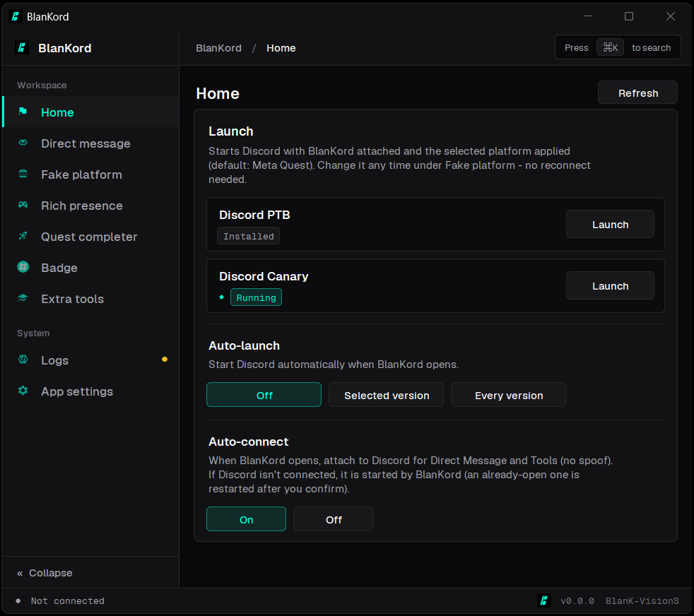
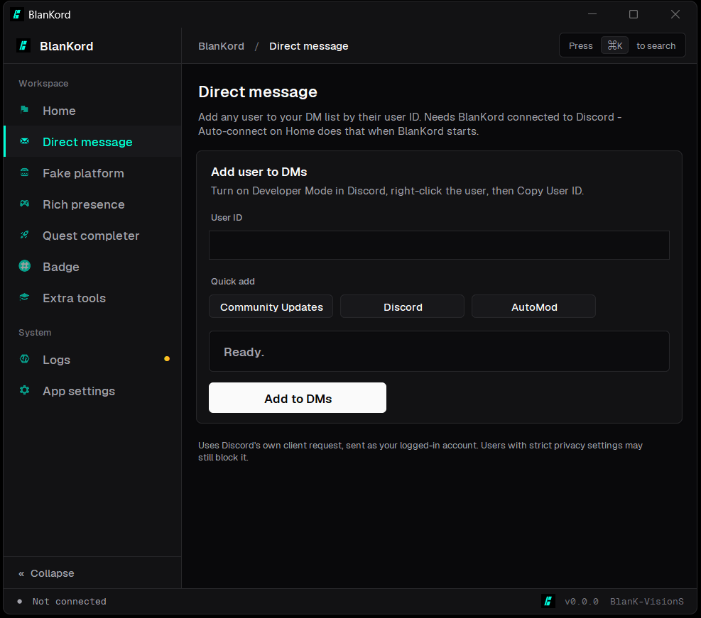
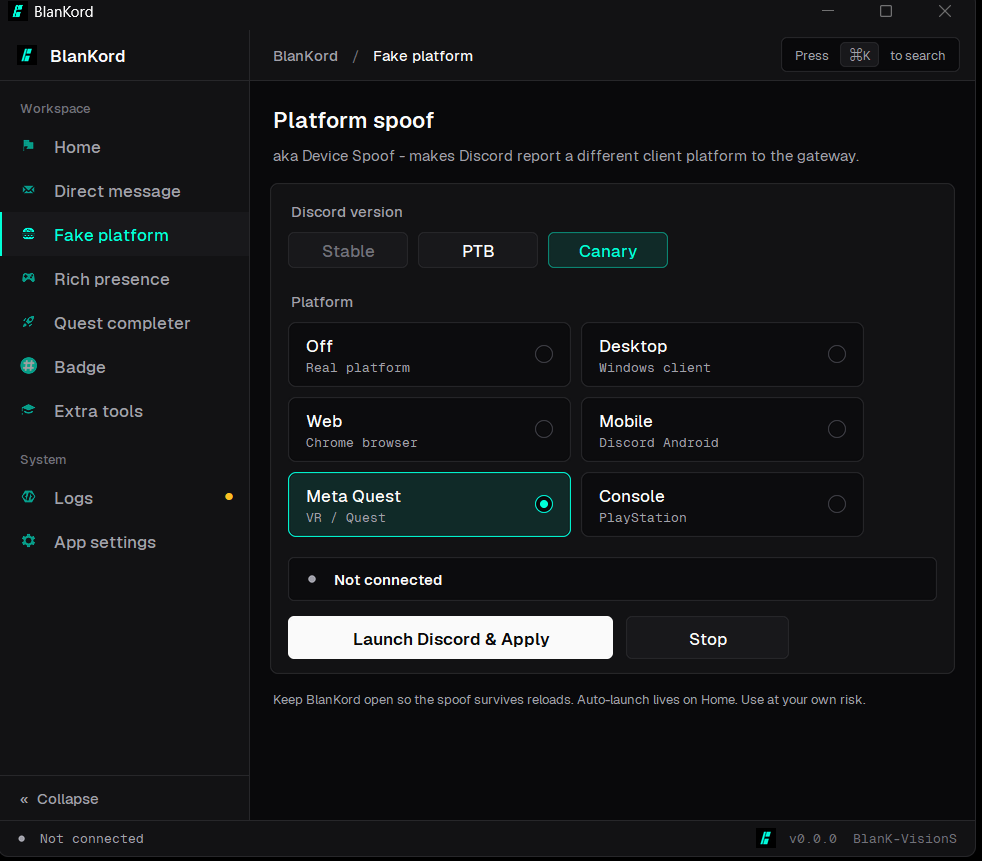
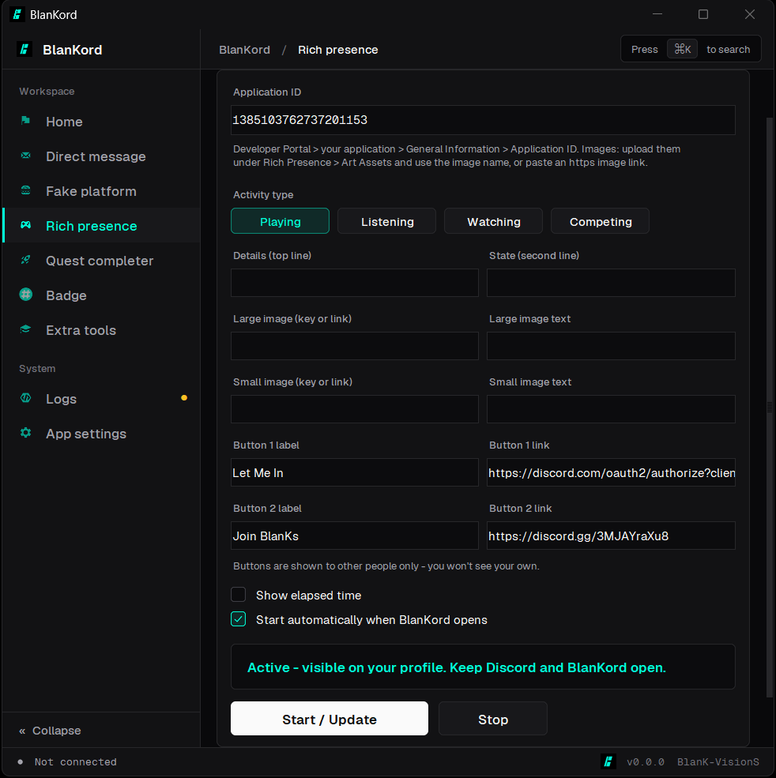
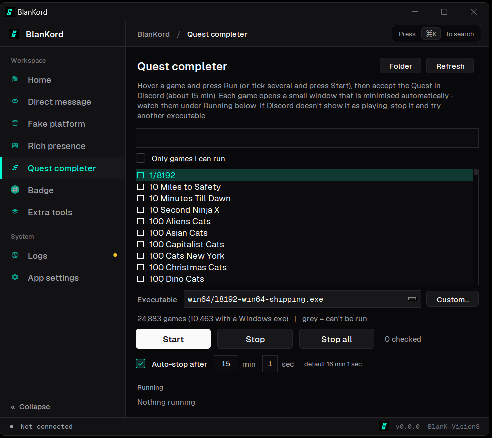
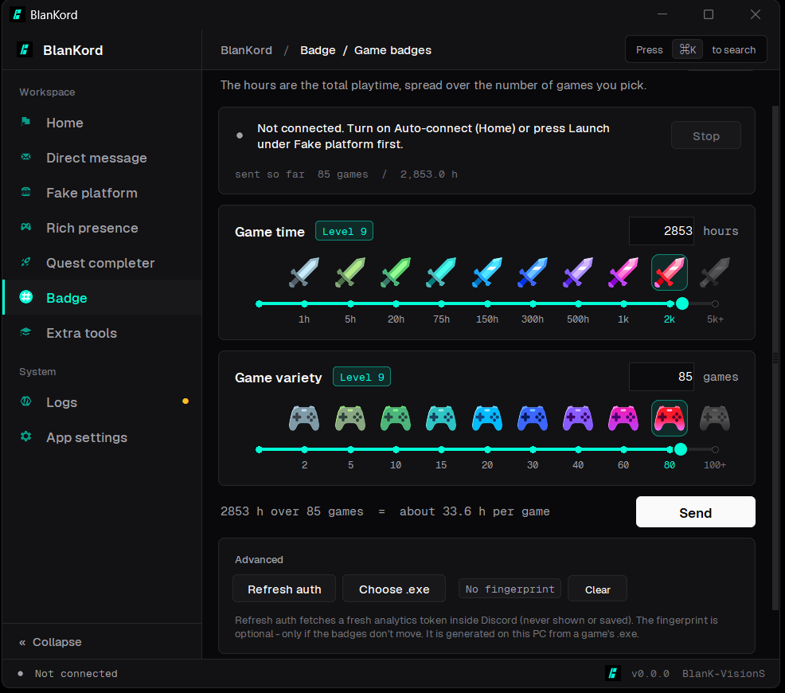
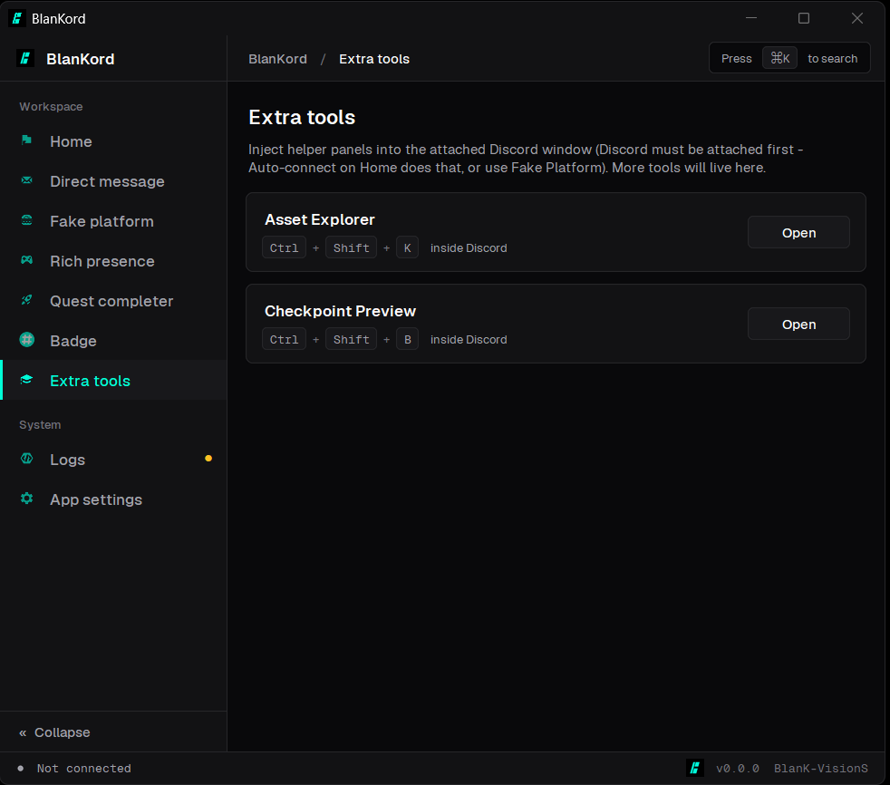
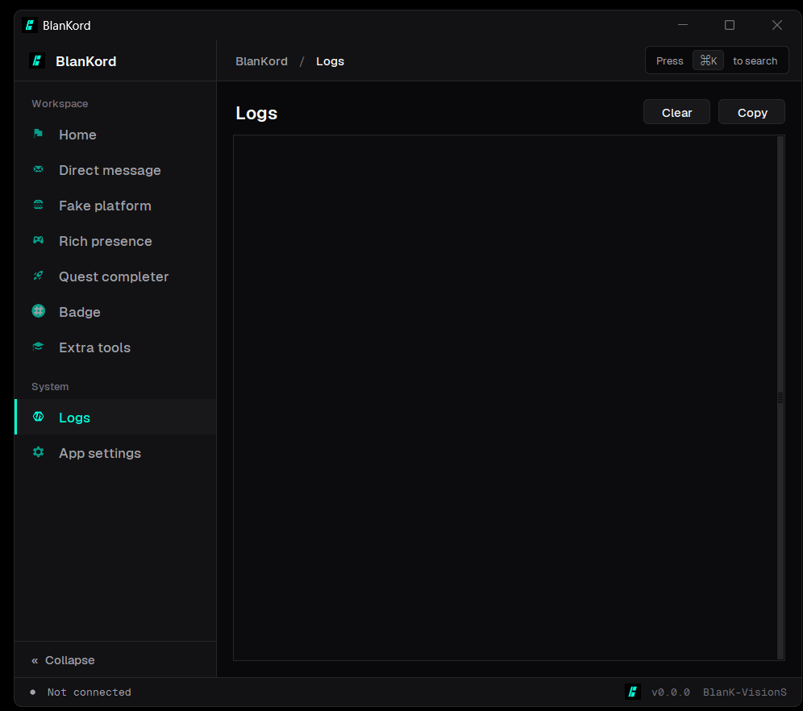
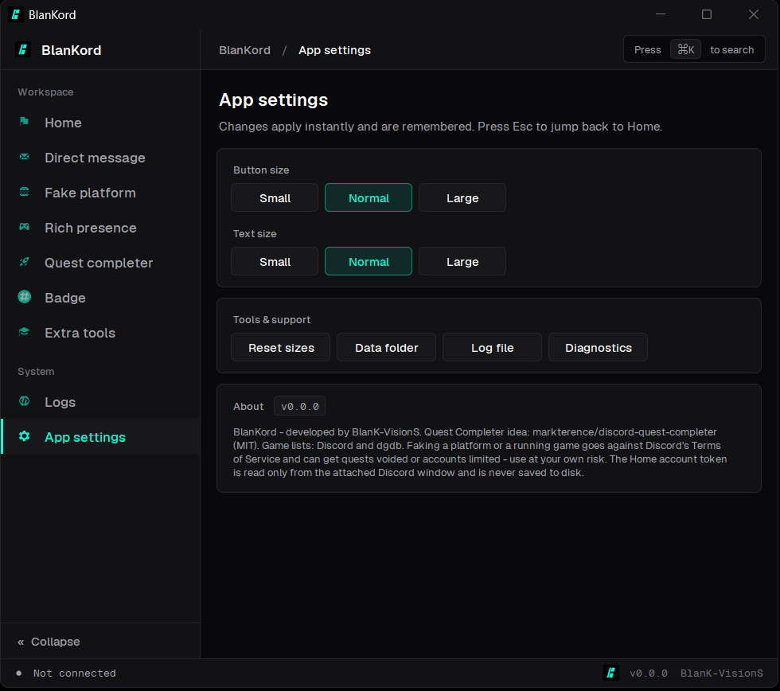

# BlanKord

BlanKord is a small Windows utility for the Discord desktop client (Stable, PTB and Canary), developed by **BlanK-VisionS**.

It brings a handful of tools together in one clean, dark interface: a platform spoof, custom Rich Presence, a Quest completer, profile badge helpers, direct message shortcuts and a few in-client developer panels. Everything runs locally on your computer.

> **Important:** BlanKord is **not open source**. Only the compiled program is distributed through the Releases page. Please read the [License](#license) and [Disclaimer](#disclaimer) sections before use.

---

## Contents

- [Features](#features)
- [Requirements](#requirements)
- [Getting started](#getting-started)
- [Using BlanKord](#using-blankord)
- [Privacy and security](#privacy-and-security)
- [Where BlanKord stores data](#where-blankord-stores-data)
- [Troubleshooting](#troubleshooting)
- [Disclaimer](#disclaimer)
- [License](#license)
- [Credits and third-party notices](#credits-and-third-party-notices)
- [Contact](#contact)

---

## Features

The sidebar gives access to every page. It can be collapsed to an icon-only strip with the button at the bottom, or with **Ctrl+B**. Press **Ctrl+K** at any time to open the command menu and jump to any page.

### Home

Shows every Discord version installed on your PC. The **Launch** button starts Discord with BlanKord attached and applies the selected platform (Meta Quest by default). Auto-launch and Auto-connect options are available on the same page.

<p align="center"></p>

### Direct message

Adds a user to your DM list by user ID.

<p align="center"></p>

### Fake platform

Makes Discord report Desktop, Web, Mobile, Meta Quest or Console to its gateway. The platform can be changed while Discord is attached, without connecting again.

<p align="center"></p>

### Rich presence

Sets a custom activity through Discord's local RPC pipe. Only an Application ID is required.

<p align="center"></p>

### Quest completer

Starts a lightweight dummy process named after a game that Discord can detect, so that Discord treats the game as running.

<p align="center"></p>

### Badge

Sends game-time and game-variety events for the related profile badges.

<p align="center"></p>

### Extra tools

One-click *Asset Explorer* and *Checkpoint Preview* panels inside the Discord window, with no DevTools console needed.

<p align="center"></p>

### Logs

A clear record of what BlanKord has done, with a status indicator for warnings and errors.

<p align="center"></p>

### App settings

Button and text size, data folder, log file and a diagnostics report.

<p align="center"></p>

---|---|
| **Home** | Shows every Discord version installed on your PC. The **Launch** button starts Discord with BlanKord attached and applies the selected platform (Meta Quest by default). Auto-launch and Auto-connect options are available on the same page. |
| **Direct message** | Adds a user to your DM list by user ID. |
| **Fake platform** | Makes Discord report Desktop, Web, Mobile, Meta Quest or Console to its gateway. The platform can be changed while Discord is attached, without connecting again. |
| **Rich presence** | Sets a custom activity through Discord's local RPC pipe. Only an Application ID is required. |
| **Quest completer** | Starts a lightweight dummy process named after a game that Discord can detect, so that Discord treats the game as running. |
| **Badge** | Sends game-time and game-variety events for the related profile badges. |
| **Extra tools** | One-click *Asset Explorer* and *Checkpoint Preview* panels inside the Discord window, with no DevTools console needed. |
| **Logs** | A clear record of what BlanKord has done, with a status indicator for warnings and errors. |
| **App settings** | Button and text size, data folder, log file and a diagnostics report. |

---

## Requirements

- Windows 10 or Windows 11
- The standard Discord desktop installer (Stable, PTB or Canary). Portable installations are not supported.
- An internet connection for downloading public game lists

BlanKord ships as a single executable. You do not need to install Python or any other component.

---

## Getting started

1. Open the **Releases** page of this repository and download the latest `BlanKord.exe`.
2. Optional but recommended: compare the SHA-256 checksum of the file with the one published in the release notes. In PowerShell:
   ```powershell
   Get-FileHash .\BlanKord.exe -Algorithm SHA256
   ```
3. Place the file in a folder of your choice and run it.
4. If Windows SmartScreen shows a warning, choose **More info** and then **Run anyway**. This can happen with any new, unsigned executable.

Only one copy of BlanKord can run at a time.

---

## Using BlanKord

### Home and Fake platform

1. Open **Home** and press **Launch** next to the Discord version you want. Discord restarts with BlanKord attached and the Meta Quest platform applied.
2. To use a different platform, open **Fake platform** and select it. The change is applied to the Discord window that is already attached, and Discord reloads once.
3. Keep BlanKord open while you want the spoof to remain active. It re-applies the spoof whenever Discord reloads.

Home also offers **Auto-launch** (off, the selected version, or every installed version) and **Auto-connect**, which attaches BlanKord to Discord on startup so that Direct Message and Extra tools are ready to use.

### Quest completer

1. Search for the game that the Quest asks for, choose an executable if there is more than one, and press **Start**.
2. Accept the Quest in Discord. The small game window is minimised automatically. Please leave it open; closing it stops the game.
3. In Discord, enable **Settings > Registered Games > Display currently running game** and **Settings > Activity Privacy > Share your detected activities**. Without these settings, nothing can be detected.

Some games are marked *not detectable yet*. They do not appear in any public list and cannot be started by name. The lists are refreshed daily, so pressing **Refresh** later may help. If a game is not detected, stop it and try another executable from the drop-down menu.

Dummy games are created in a `BlanKord-games` folder next to the executable, or in `%APPDATA%\BlanKord\games` when that location is read-only. If a dummy closes immediately, antivirus software or SmartScreen is most likely blocking it, and the Logs page will say so.

### Badge

The Badge page requires Discord to be attached. The first option is **Game badges**, which offers two sliders:

- **Game time**: total hours, with stops at 1, 5, 20, 75, 150, 300, 500, 1,000, 2,000 and 5,000+ hours.
- **Game variety**: number of games, with stops at 2, 5, 10, 15, 20, 30, 40, 60, 80 and 100+ games.

You can drag a slider or type an amount; both stay in sync. **Send** spreads the chosen hours across the chosen number of games. Badges are updated on Discord's side after one to two days.

Under **Advanced**, *Refresh auth* obtains a fresh analytics token inside Discord (it is never shown or saved), and *Choose .exe* generates an optional executable fingerprint on your PC if the badges do not move.

---

## Privacy and security

- BlanKord runs locally. Apart from downloading public game lists (a GitHub mirror, dgdb and Discord's public detectable list), it sends nothing anywhere.
- BlanKord **never reads, copies or stores your account token or cookie**. Badge events are posted from inside the attached Discord window through Discord's own request code, which adds the login and client headers by itself.
- Settings are saved in `config.json` and never include account credentials.
- Discord is started with Chrome's debugging port bound to **127.0.0.1 only**, and only the origin `http://127.0.0.1:<port>` is allowed to connect, so websites cannot reach it. As with any debugging port, a program that is already running on your PC could connect to it. Close BlanKord and Discord when you are finished.
- Executable paths taken from game lists are validated and always remain inside the games folder.

---

## Where BlanKord stores data

All data is kept in `%APPDATA%\BlanKord\`:

- `config.json` - your settings
- `BlanKord.log` and `BlanKord.log.1` - the log file and its backup, rotated at 512 KB
- `games_v3.json` - a cache of the game list, refreshed daily

Delete this folder to reset BlanKord completely.

---

## Troubleshooting

- **"BlanKord is already running"**: only one instance is allowed. Check the taskbar and the system tray.
- **Discord not found**: BlanKord looks in `%LOCALAPPDATA%\Discord*`. Install Discord with the normal installer, then press **Refresh** on Home.
- **Discord does not detect a Quest game**: check the two Discord settings listed in the Quest completer section, then try a different executable.
- **Anything else**: open **App settings** and use **Diagnostics**. It copies a report (versions, sources and the latest log lines) that you can include when you contact the developer.

---

## Disclaimer

Spoofing a platform, simulating a running game and sending game-activity events all go against Discord's Terms of Service. Using these features can lead to Quest rewards being voided or to your account being limited or suspended. **Use BlanKord entirely at your own risk and preferably only on an account you can afford to lose.**

BlanKord is provided "as is", without warranty of any kind. The developer is not responsible for any loss, restriction or damage resulting from its use.

BlanKord is an independent project. It is not affiliated with, endorsed by or connected to Discord Inc. "Discord" is a trademark of Discord Inc.

---

## License

Copyright (c) BlanK-VisionS. All rights reserved.

BlanKord is proprietary software and is **not open source**. The source code is not published. The compiled program is made available free of charge for personal, non-commercial use only.

Without prior written permission from the developer, you may not:

- decompile, disassemble or reverse engineer the program, or attempt to extract its source code;
- modify the program or create derivative works from it;
- redistribute, re-upload, resell or repackage the program, whether modified or not;
- remove or alter the author's name, version information or notices.

You may share a link to this repository. Third-party components included in BlanKord remain under their own licenses, as described below.

---

## Credits and third-party notices

BlanKord builds on the work of others, and the developer is grateful to them:

- **discord-quest-completer** by Mark Terence Tiglao (MIT License): the idea behind the Quest completer and the optional native dummy game executable. <https://github.com/markterence/discord-quest-completer>
- **dgdb**: a daily mirror of Discord's detectable-applications list, used as one of the game-list sources. <https://github.com/teyd/dgdb>
- **discord-badge-spoofer** by revere group (MIT License): the event format used by the Badge page. The executable fingerprint generator was reverse engineered by dolfies. <https://gist.github.com/dolfies/d442777ab8354e18c1a3827e27f85c3a>
- **Geist** and **Geist Mono** fonts by Vercel, in collaboration with basement.studio (SIL Open Font License 1.1). <https://github.com/vercel/geist-font>
- **websocket-client** (Apache-2.0), **Pillow**, **PyInstaller** (GPL-2.0 with the bootloader exception) and **Python / Tcl/Tk** (PSF and Tcl licenses).

The complete license texts are included in `THIRD_PARTY_NOTICES.txt`, which is distributed together with every release.

---

## Contact

Questions, bug reports and suggestions are welcome through the **Issues** tab of this repository. When reporting a problem, please attach the report from **App settings > Diagnostics** and mention your Windows and Discord versions.

Developed by **BlanK-VisionS**.
